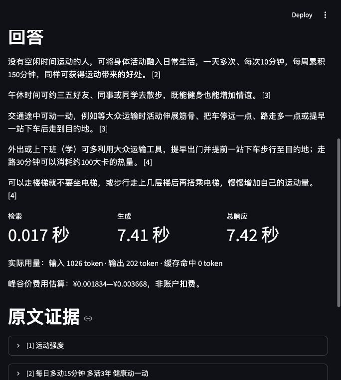

# 大学生日常健康知识 · 证据问答

面向一般成年人睡眠、饮食和运动知识的课程项目。比较传统 BM25 原文基线，以及 BM25、句向量、混合检索三条 DeepSeek RAG 路线。知识库固定版本，不实时搜索网页；引用定位到原文单位。

**正在开发，不是已完成的满分提交物。**当前状态与真实缺口见 [docs/STATUS.md](docs/STATUS.md)，评分逐项验收见 [docs/ACCEPTANCE.md](docs/ACCEPTANCE.md)。AI评分与小组实际复核分别记录；没有完成的实验不填分数。

## 环境与启动

目标平台：Apple Silicon macOS、Windows 11 x64；无需 CUDA 或独立显卡。Python 3.11 由 uv 管理，依赖固定在 `uv.lock`。首次需要联网下载依赖、约96MB的嵌入模型及资料。真实兼容性以验收记录为准。

1. 安装 [uv](https://docs.astral.sh/uv/getting-started/installation/)，下载或克隆仓库并进入项目根目录。
2. 可把 `.env.example` 复制为 `.env`，在本机填写 DeepSeek 官方密钥；也可启动页面后在页顶“运行设置”输入当前会话密钥。不要提交密钥或发到聊天。B0不调用生成API。
3. 执行：

```sh
uv run --locked campus-health doctor --network
uv run --locked campus-health prepare
uv run --locked campus-health demo
```

页面仅监听本机 `127.0.0.1`。录屏身份可通过 `.env` 的 `DEMO_NAME`、`DEMO_STUDENT_ID` 设置，不公开提交。

页顶“运行设置”打开配置面板，默认使用DeepSeek官方，展开“接口、密钥与模型”即可编辑配置。页面输入的密钥优先于本机密钥，输入框不回显`.env`；取消“使用本机.env / 环境变量密钥”即可仅使用页面输入。切换“自定义兼容接口”后填写Base URL、自己的密钥和模型ID，自定义接口不会继承DeepSeek密钥。可点击获取模型列表，也可直接手填模型ID；连接测试会实际发送一次短请求并产生少量费用。“密钥已配置”不表示连接检查已经通过。

会话密钥只在当前会话内使用，不写入文件、日志、URL或缓存；“清除会话配置”会清除页面配置、关闭本机密钥回退并切回B0，保留问题，不修改`.env`。非本机接口须使用HTTPS，不接受带账号、查询参数或片段的地址，不跟随API重定向。连接检查仅验证当前配置能连接并返回约定JSON，不代表所有模型能力兼容。自定义供应商目前仅有模拟接口验收，尚无外部供应商实测。

页面切换模型只影响演示，不改变正式实验配置。演示单独记录接口、请求/实际模型、参数、token与延迟；未核价模型费用显示“未配置价格”，不套用DeepSeek价格。命令行和正式实验继续使用本机`.env` / 环境变量配置，正式测试前仍须冻结协议。

首页默认填入运动例题，首次已有密钥配置时默认混合问答R3，否则默认原文检索B0。点击“检索原文”或“查找证据并回答”即可体验；三主题示例只填入问题，不会自动调用API。生成答案与证据在宽屏并排、窄窗口上下排列；B0直接展示原文，不生成概括。修改问题、方法或接口配置后，旧结果会标记为尚未重新运行。失败后可重试，或切回B0再点击运行。运行记录中的百分比附有效题数，并提示历史语料与当前版本是否一致；完整指标、耗时与原始记录可展开查看。资料来源支持中文主题与标题筛选及一键清除。演示环境关闭源码文件监视，修改源码后需重新启动服务。

UI迭代过程、真实截图与分阶段验证见 [docs/UI_PROGRESS.md](docs/UI_PROGRESS.md)。

无需API密钥也可以检查真实CPU检索层（包括向量模型）：

```sh
uv run --locked campus-health retrieve "怎样在日常生活中增加身体活动？" --method R3
```

开发取数（不等同固定版本复现）：

```sh
uv run --locked campus-health fetch-sources
```

`prepare` 只获取/校验指定版本，不在下载失败时偷偷爬取新版。源码开发期间若release尚未发布，会明确报错。

## 一条命令重跑主结果

完成前置准备和小组题集/协议实际审核后：

```sh
uv run --locked campus-health reproduce
```

预期生成 `runs/<UTC时间>_formal-test/`：运行清单、完整逐题输出、实际API用量、评分原始输出、汇总JSON/CSV。默认四种方法，测试集90题应有360条方法输出。是否成功、失败/评分错误、各指标实际分母单独统计。

**当前正式评估关卡尚未通过，因此命令会拒绝跳过小组审核。**不要删除关卡来伪造“正式测试已完成”。开发可先运行：

```sh
uv run --locked campus-health draft-questions
uv run --locked campus-health validate-questions
uv run --locked campus-health evaluate --exploratory --split dev --limit 3
```

这里的题目为AI草稿，分数为探索结果，不是报告的正式测试成绩。

单因素参数比较（默认完整开发集；`--limit 12` 为三主题/四题型的平衡小批量功能验证）：

```sh
uv run --locked campus-health sweep --limit 12
```

正式参数结论应在核验后的30道开发题上取得，不能把小批量验证冒充完整实验。

仅重算已保存输出（不重新调用API）：

```sh
uv run --locked campus-health audit runs/<实际运行目录>
uv run --locked campus-health export-review runs/<实际运行目录>
```

续跑使用同样的配置、题集、方法、限制、模型并添加 `--resume runs/<实际目录>`；代码/数据/依赖变更则拒绝拼接。失败项保留在原运行，修复后创建新运行，不覆盖。

## 方法与指标

| 方法 | 检索 | 输出 |
|---|---|---|
| B0 | jieba+BM25 | 原文及来源 |
| R1 | BM25 | DeepSeek依证据回答 |
| R2 | BGE-small-zh-v1.5 | 同一生成模型和提示 |
| R3 | RRF融合BM25和句向量 | 同一生成模型和提示 |

配置在 `configs/default.json`：种子20261016、CPU、chunk约256嵌入token、overlap约32、top-k=4。句子/证据单位不依赖切块配置；不静默截断。模型使用固定commit，下载后校验文件。

检索召回：每题必须证据组被top-k联合覆盖的比例；组内允许等价原文替代。精确率：top-k中包含标注证据单位的块比例。无答案题的检索指标不混入均值。

答案要点覆盖、事实依据、引用支持采用明确规则的AI辅助评分，并保留理由，需小组复核校准。引用编号有效只说明结构正确，不代表结论获支持。B0不具备拒答能力，该指标记不适用。

延迟分首次准备、检索、生成、总响应；评分不计入用户响应时间。费用按官方峰谷价与实际token给区间估算，分别汇总回答、评分、草稿及未知费用的失败请求，非账户实际扣费。每个API调用都有真实原始记录。

## 数据与许可

`configs/sources.json` 是来源清单。只用文字，不包含机构标识、第三方图片或附件。原文与繁简标准化文本分存，保留适用条件与地区，不冒充中国大陆营养标签法规。

- [卫生福利部开放声明](https://www.mohw.gov.tw/cp-81-155-1.html)
- [国民健康署开放声明](https://www.hpa.gov.tw/Pages/Detail.aspx?nodeid=92&pid=5141&sid=5140)
- [BGE模型与许可](https://huggingface.co/BAAI/bge-small-zh-v1.5)
- [DeepSeek官方接口](https://api-docs.deepseek.com/zh-cn/)

原始材料不能因公开可读就视为开放许可，特殊或第三方授权材料排除。原创代码MIT许可不覆盖资料、模型与依赖。课程官方三份文件保留在本地，不随公开仓库重新分发。

当前开发数据：[data-v0.1.0-dev](https://github.com/Harry6400/campus-health-rag/releases/tag/data-v0.1.0-dev)。它包括资料与120题AI初稿，尚未小组冻结。

## 真实界面证据

以下截图来自本机实际R3问答及DeepSeek调用，非效果图、非正式评估成绩：



## 安全与故障

- `.env`、原始运行、模型、数据、个人核验内容默认不进Git。分享证据前检查密钥、隐私和个人身份。
- API鉴权失败先检查本地密钥；限流/临时故障有限重试，其他错误明确停止。失败不是正常拒答。
- 下载失败可按校验清单手动放置文件，不换用未校验版本；证书使用系统信任库，不关闭TLS。
- API服务可能更新，记录实际模型及请求条件。种子只约束本地随机过程，不保证API输出逐字一致。

## 验证与课程交付

```sh
uv sync --locked --group dev
uv run --locked pytest -q
uv run --locked ruff check src tests
```

公开CI只做无密钥CPU夹具检查；它不代表Windows端真实API全链路已通过。Mac和队友Windows验收必须独立留原始记录。

最终只交一个≤50MB ZIP：源码/README、8—12页八节PDF、≤300字摘要、每人贡献声明；AI声明在报告，≤2分钟真实录屏含难例和身份信息，以网盘链接提交。模型/数据/视频/环境/密钥不进ZIP。正式截止2026-10-30 24:00，无答辩，不额外制作PPT。
